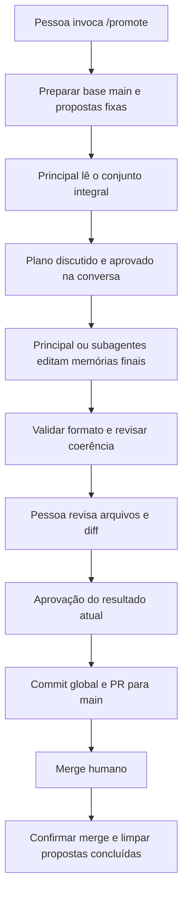

# Promote Simplification Design

**Spec:** `.specs/features/promote-simplification/spec.md`
**Status:** Abordagem A confirmada; detalhamento técnico e 14 tarefas prontos para revisão. Os validadores de spec e tarefas passaram; código ainda não alterado.
**Approach confirmed:** 2026-11-03 - user: "aceito A"

## Architecture Overview

Recomenda-se manter ferramentas MCP pequenas para o ciclo Git/GitHub e dar ao skill acesso direto aos arquivos do worktree. O Go prepara o ambiente, valida o formato e publica o resultado atual aprovado. O agente organiza o conhecimento na conversa, escreve memórias finais e conduz a revisão. Nenhum componente representa decisões individuais de promoção, grupos persistentes ou sessão retomável.



### Approach Comparison

As duas abordagens entregam o mesmo escopo aprovado e usam arquivos finais editáveis.

| Approach | Operation | Trade-off |
| --- | --- | --- |
| A. MCP pequeno + arquivos diretos — recomendada | O skill usa ferramentas MCP para preparar, validar, enviar e concluir; usa leitura/edição de arquivos para o trabalho nas memórias. O comando explícito de conclusão chama o mesmo núcleo Go. | Reaproveita a integração atual e suas respostas estruturadas. Mantém o shell fora da interface de publicação do agente, sem obrigar operações por proposta. |
| B. CLI + arquivos diretos | O skill chama comandos `gpm` para as mesmas etapas, além de ler e editar os arquivos. O núcleo Go continua responsável por Git/GitHub. | Reduz ferramentas MCP de promoção, mas passa a exigir execução de comandos pelo agente e interpretação das saídas da CLI em todas as etapas. |

A recomendação é A. O repositório já instala o skill e registra o MCP para o Claude Code; reduzir o contrato existente evita criar outra interface principal só para este fluxo.

A escolha A foi confirmada pelo usuário. A CLI não será a interface principal do skill; conserva somente a conclusão explícita após merge.

## Components

### Workspace preparation

- **Location:** `internal/workspace/workspace.go`.
- Centralizar o novo layout em `Paths.Promotions`, sob `<state>/<repo-id>/promotions`.
- `NewPromotion(ctx, baseSHA)` cria uma branch `promote/<UTC>-<random>` e um worktree em `<promotions>/<id>/worktree`; retorna também `<promotions>/<id>/inputs` para os insumos de leitura.
- Usar a revisão exata capturada de `origin/main`. Não mesclar a `proposals` na branch de promoção nem criar commits na abertura.
- Não selecionar worktree anterior, remover diretórios existentes ou implementar retomada.
- Manter os helpers e locks usados por leitura, configuração e inbox.

### Canonical document preparation

- **Location:** novo `internal/memory/document.go`.
- `PrepareDocument(path, baseline, current)` completa IDs ausentes e valida o documento completo. Reaproveita o parser e as regras de IDs existentes; não chama preview/reconcile ou transações.
- Preservar IDs existentes e frontmatter do baseline. Os agentes preservam os marcadores de seções mantidas durante a edição.
- Aceitar documentos já preparados, inclusive headings novos que receberam IDs numa conferência anterior; repetir a conferência não muda esses IDs.
- Não decidir conteúdo, alterar a prosa, impor categorias novas ou redefinir os limites do formato canônico.

### Consolidation core

- **Location:** novo pacote `internal/consolidation`.
- `Manager` recebe a configuração e usa o workspace e o client GitHub existentes.
- `Prepare(ctx)` captura `main` e `proposals`, inventaria as memórias e copia os blobs das propostas para `inputs`. Retorna caminhos, revisões e inventários, sem despejar todos os conteúdos na resposta MCP. A integração MCP chama `Finish(ctx)` antes de uma nova preparação quando há comprovante publicado; assim a preparação do núcleo pode ser implementada e testada independentemente da conclusão.
- A cópia vem de `git ls-tree`/`cat-file` na revisão fixa, nunca de uma listagem viva após a captura. Falha de leitura é erro explícito. O `/remember` conserva sua listagem atual.
- `Check(ctx)` prepara os IDs dos arquivos editados e retorna caminhos alterados e o diff dos arquivos atuais, incluindo arquivos novos. Não cria commit nem token e não armazena previews.
- `Submit(ctx, summary)` valida os arquivos atuais sem modificá-los, cria um commit único com os caminhos canônicos alterados, faz push sem force e abre PR para `main`. `summary` é Markdown livre com o destino ou justificativa de cada proposta, produzido pelo principal.
- `Finish(ctx)` consulta o PR do comprovante local, confirma merge e presença do commit de merge na `origin/main`, e remove somente propostas com os mesmos caminhos e blobs aprovados. Usa o checkout de `proposals` atualizado por fast-forward e um push comum sem loop de retry.
- Após a limpeza, atualizar o worktree de leitura usando seu lock existente. Não mesclar memórias na `proposals` como pré-condição da limpeza; o `/remember` já escreve só propostas e a leitura usa a `main`.
- A execução ativa existe somente na memória do processo MCP. Um comprovante de publicação é lido para a limpeza posterior, nunca para retomar edição.

### MCP adapter

- **Location:** `internal/mcpserver/server.go`.
- Manter quatro ferramentas de promoção, com o envelope `schema_version`, `data` e `error` já usado no projeto:

| Tool | Input | Result / effect |
| --- | --- | --- |
| `memory_promote_prepare` | Sem argumentos | Worktree, diretório de insumos, branch, revisões, categorias e inventários de propostas/memórias. |
| `memory_promote_check` | Sem argumentos | Prepara IDs e retorna diff e caminhos alterados. É a conferência dos arquivos atuais, sem token ou aplicação posterior de uma cópia armazenada. |
| `memory_promote_submit` | `summary`: Markdown livre da consolidação | Commit global, push e URL/número do PR; exige a aprovação prévia conduzida pelo skill. |
| `memory_promote_finish` | Sem argumentos | Confirma merge e executa a limpeza registrada no comprovante. |

- O servidor mantém um `Manager` para o trabalho em andamento. Não persistir estado de execução nem criar status/enum de promoção.
- Remover `memory_promote_open`, `memory_promote_status`, previews, applies, batch tools, caches de tokens e recuperação na inicialização.
- Desacoplar `memory_proposal_list` de `internal/promotion`, usando inbox e categorias existentes. Ela continua servindo à captura; o novo `/promote` usa os insumos fixos retornados na preparação.
- As ferramentas de leitura continuam atendendo a memória publicada. Remover a opção de fonte `release`; o skill lê os arquivos do novo worktree para enxergar o que está preparando.
- O handler de preparação conclui primeiro uma publicação anterior já mergeada. Se o PR do comprovante ainda está aberto, informa que aguarda merge e não inicia outra promoção.

### CLI completion

- **Location:** `internal/app/app.go`.
- Conservar `gpm promote --finish` como entrada explícita para o mesmo `Finish` do núcleo.
- Retirar `--resume`, `--abort` e o fallback que aceita a palavra da pessoa como prova de merge quando `gh` não está disponível. Não criar CLI para as outras três etapas.
- Mostrar o resultado da confirmação/limpeza ou seu erro. Não adicionar ciclo de recuperação.

### Promote skill

- **Location:** `integrations/claude-code/skills/promote/SKILL.md`.
- Exigir invocação explícita, preparar e ler integralmente os inventários usando os caminhos recebidos.
- Discutir na conversa agrupamentos, destinos e justificativas, com exemplos de relações nos dois sentidos. Não criar arquivo de plano ou tabela por fato.
- Esperar aprovação do plano antes de editar. Delegar por memória quando útil e disponível, com responsável exclusivo, contexto atual e decisões aprovadas. Os subagentes não executam Git ou publicação.
- O principal relê o conjunto e chama `memory_promote_check` antes de apresentar resumo e diff para revisão.
- Encerrar a escrita dos agentes antes da edição humana. Novos ajustes partem dos arquivos atuais. Uma nova conferência que altera arquivos antecede uma nova apresentação do diff, nunca modifica silenciosamente o resultado depois da aprovação.
- Após aprovação do resultado atual, chamar `memory_promote_submit`. Não usar Git/Bash para publicar por fora desse suporte.
- `allowed-tools` inclui as quatro ferramentas MCP e ferramentas nativas de leitura/edição/delegação (`Read`, `Write`, `Edit`, `Glob`, `Grep`, `Agent`), conforme a documentação oficial. Sua disponibilidade efetiva e o acesso ao diretório externo seguem as permissões da sessão; não alterar permissões globais automaticamente.
- Não pressupor que `allowed-tools` restringe o conjunto de ferramentas ou que sua autorização dura a conversa inteira: o contrato de responsabilidades fica nas instruções do skill. Registrar na documentação como conceder acesso ao caminho do worktree quando o ambiente solicitar.

## Data Models

Os nomes abaixo definem contratos internos; detalhes Go seguem os padrões existentes, sem novas dependências.

```go
type ProposalInput struct {
    ID, Path, Title, Blob, InputPath string
}

type Prepared struct {
    Worktree, InputsRoot, Branch string
    MainSHA, ProposalsSHA string
    Categories, MemoryPaths []string
    Proposals []ProposalInput
}

type Published struct {
    PRNumber int
    PRURL, Branch string
    Proposals []ProposalBlob
}

type ProposalBlob struct {
    Path, Blob string
}
```

`Prepared` permanece na memória do processo. Os arquivos de `inputs` são cópias para leitura. Não escrever `prepared.json`, plano ou estado serializado da execução.

`Published` é salvo somente depois da criação do PR em `<state>/<repo-id>/promotion-published.json`, fora do worktree. Guarda exclusivamente o vínculo necessário à limpeza. Não contém prosa das memórias, conteúdo das propostas, plano, grupos, decisões de operação ou status de etapas. Seu caminho também é definido pelo workspace. Depois da limpeza bem-sucedida, esse comprovante pode ser removido.

Um único comprovante pendente é suficiente para a premissa de uma promoção por vez. Não implementar descoberta de promoções de outras pessoas nem retomada entre processos ou máquinas. PR ainda aberto é apresentado como aguardando merge; isso não retoma a edição.

## Error Handling Strategy

| Condition | Handling |
| --- | --- |
| Nenhuma proposta na revisão capturada | Informar e encerrar sem worktree de publicação ou PR. |
| Falha de leitura, Git, rede ou GitHub | Devolver erro e parar; sem retry, rollback ou remoção automática de trabalho. |
| Documento canônico inválido | Informar o caminho e o erro de formato. Ajustes e nova conferência ocorrem antes da aprovação final. |
| Contexto insuficiente para análise integral | O skill explicita a limitação e para, sem particionamento automático ou alegação de completude. |
| PR ainda não mergeado | Manter propostas e comprovante, informar que falta merge. |
| Proposta nova ou com conteúdo alterado | Preservar seu arquivo na limpeza. |
| Nenhum comprovante publicado | A conclusão informa que não há publicação para concluir; uma preparação normal pode começar. |

Falhas depois de um efeito parcial podem deixar commit, branch ou PR disponíveis. A versão não promete recuperação automática ou repetição segura da publicação. Não implementar essas capacidades para preencher lacunas desse cenário excluído.

## Code Reuse Analysis

| Component | Location | Reuse |
| --- | --- | --- |
| Diretório de estado e worktrees | `internal/workspace/workspace.go` | Estender o layout por repositório com caminhos de promoção e comprovante. Preparar nova branch a partir da revisão de `main`; não usar a abertura antiga de release. |
| Configuração e categorias | `internal/config/config.go` | Manter categorias configuradas e reconhecimento dos caminhos canônicos. |
| Leitura de propostas | `internal/inbox/proposal.go` | Reaproveitar convenção de nomes, título e padrão de leitura de blobs; a preparação usa revisão fixa e não muda a semântica de listagem do inbox. |
| IDs e validação canônica | `internal/memory/page.go`, `schema.go` | Reaproveitar as regras de estrutura e IDs sem exigir operações individuais de seção ou página na promoção. |
| GitHub | `internal/forge/github/github.go` | Reutilizar autenticação, criação de PR e consulta de merge. |
| MCP e erros estruturados | `internal/mcpserver/server.go` | Manter o transporte existente, removendo previews, folds e recuperação na inicialização. |
| Testes Git locais e GitHub simulado | `internal/release/`, `internal/mcpserver/`, `tests/e2e/` | Reutilizar fixtures e fake de `gh` para provar publicação e limpeza sem acesso remoto real. |

## Scope Constraints

- O plano permanece na conversa. Não salvar Markdown de plano, sessão ou estados para retomada.
- Os dados que persistem para a limpeza ligam o PR às propostas concluídas e seus conteúdos de origem. Não reconstroem a conversa ou a edição.
- Apenas memórias aprovadas entram no commit; insumos de propostas e dados auxiliares ficam fora.
- O principal pode delegar por memória após a aprovação do plano; Git e publicação permanecem sob sua responsabilidade.
- O agente encerra sua rodada de escrita antes da revisão humana e relê os arquivos atuais ao fazer ajustes.
- A limpeza depois de merge é parte do fluxo aprovado. Não implementar reabertura de PR, recuperação ou compatibilidade com promoções antigas.
- A implementação não precisa coordenar outra promoção, reconciliar avanço da `main` nem particionar automaticamente conjuntos grandes.

## Risks & Concerns

| Concern | Location | Impact | Mitigation |
| --- | --- | --- | --- |
| Servidor concentra lifecycle de release, caches de preview e recuperação | `internal/mcpserver/server.go:26` | Trocar apenas os handlers deixaria o modelo antigo ativo. | Planejar a retirada de campos, recuperação, contratos e dependências no mesmo corte de integração. |
| Leitura MCP aceita `source: release` | `internal/mcpserver/server.go:266` | A leitura pode continuar dependendo do manager antigo. | Preservar o contrato de leitura publicada e usar os arquivos do novo worktree no `/promote`. Tratar a retirada do seletor antigo na integração. |
| Listagem de propostas usa HEAD da branch local e pula entradas ilegíveis | `internal/inbox/proposal.go:24` | A análise pode misturar propostas novas ou declarar inventário completo sem ler tudo. | A preparação deve ler a revisão capturada, sem atualizar silenciosamente o conjunto; erros de leitura interrompem a preparação. |
| Formato canônico exige IDs que edição direta pode omitir | `internal/memory/schema.go:11`, `internal/memory/page.go:140` | Arquivos legíveis em Markdown podem ser rejeitados pela leitura publicada. | Completar IDs antes da revisão final e usar o validador canônico; testar preservação de IDs e publicação de bytes atuais. |
| Finalização atual depende de marcador remoto e remove por ID | `internal/release/finish.go:139` | Reutilizar esse método manteria lock ou apagaria uma proposta modificada. | Implementar a limpeza simples a partir do vínculo PR/propostas, exigindo correspondência de caminho e conteúdo e confirmação de merge. |
| Testes codificam o comportamento removido | `tests/claudeadapter/promote_create_test.go:10`, `tests/e2e/phase3_test.go:208` | Os testes antigos exigem previews, folds e retomada. | Listar nas tarefas a substituição dos testes desses contratos, mantendo regressões de captura e leitura. A aprovação das tarefas deve tornar essa substituição explícita. |
| Testes do skill verificam trechos de texto | `tests/claudeadapter/promote_create_test.go:10` | Texto presente não prova o julgamento semântico de um LLM. | Separar provas do contrato escrito de testes executáveis de Git/MCP e registrar a avaliação semântica na verificação independente. Não declarar cobertura comportamental baseada só em strings. |
| Arquivos estão fora do diretório do projeto da sessão Claude | `internal/workspace/workspace.go`, documentação oficial de ferramentas | Acesso direto pode exigir autorização para o caminho do worktree; frontmatter não garante acesso permanente. | Informar caminhos absolutos e documentar a autorização normal de diretório, sem prometer acesso que o host não concede ou mudar configurações globais. |
| Go não está no PATH desta sessão | `go.mod`, `Makefile`, inspeção do ambiente | Gates de implementação dependem de Go 1.25.12. | Localizar um toolchain existente ou disponibilizar a versão exigida antes da execução; não considerar testes executados nesta etapa de planejamento. |

## Validation Basis

- `Makefile`: `make verify` executa testes, testes com race detector, `go vet` e build usando Go 1.25.12.
- `.github/workflows/ci.yml`: usa o mesmo `make verify`.
- Esta etapa não altera código da aplicação nem testes e não executa publicação remota.
- `validate_spec.py promote-simplification` passou sem erros antes da aprovação da especificação.
- Documentação oficial consultada em 2026-11-03: [skills e allowed-tools](https://code.claude.com/docs/en/skills), [ferramentas nativas](https://code.claude.com/docs/en/tools-reference), [subagentes](https://code.claude.com/docs/en/sub-agents). Base para os nomes de ferramentas, permissões e delegação; não acrescenta requisitos de produto.

## Test Strategy

- Usar `testing` do Go e os remotos bare/fake `gh` já presentes no projeto. Nenhum teste de aceitação publica em serviço real.
- Cobrir os efeitos programáticos com testes de bytes, árvores Git, commits, requests MCP e chamadas ao fake GitHub: revisão fixa, dezessete propostas, IDs, arquivos novos, edição humana, exclusão de auxiliares e limpeza depois de squash.
- Verificar as instruções do skill por testes nomeados de contrato. Esses testes provam a presença/ordem das obrigações escritas, não garantem o julgamento de um modelo em produção. O Verifier avalia os exemplos de consolidação, preservação de conhecimento e coerência global na leitura independente.
- Substituir apenas testes que exigem comportamento explicitamente removido: folds, tokens, previews, lock de release, retomada, rollback, recovery e fallback manual de merge. Conservar regressões de inbox, leitura, setup, formato e locks compartilhados.
- Os testes legados de `internal/release` importam `internal/promotion`, e um teste de transação de promoção usa o helper `OpenRelease` de `workspacetest`. A retirada desses dois pacotes é um único corte atômico do componente antigo, depois que suas interfaces e testes de integração já foram substituídos. Separá-los produziria um commit que não compila.
- A suite E2E existente depende dessas ferramentas antigas. Atualizá-la no corte MCP, junto dos testes de transporte que deixam de compilar ou chamar endpoints válidos.
- Uma prova selecionada por critério fica em `tasks.md`; testes novos acompanham o componente entregue em cada commit.

## Next Step

Revisar e aprovar `tasks.md`. A aprovação autoriza execução e commits locais, sem autorizar push, PR ou deploy deste repositório de desenvolvimento. O comportamento de publicar PR descrito aqui é implementado e testado em ambiente simulado.
